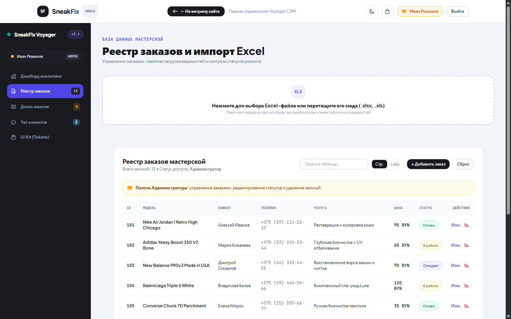
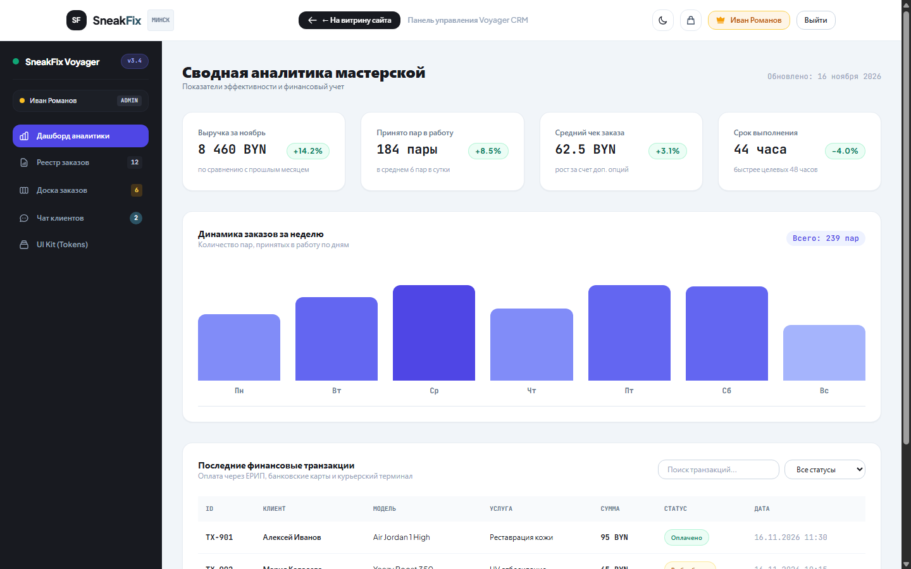
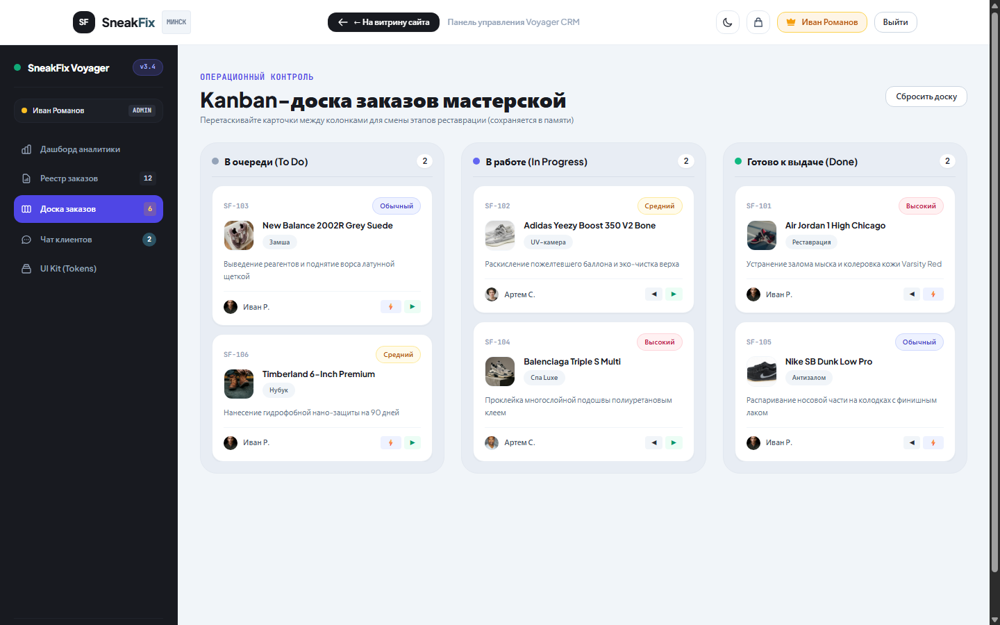

<div align="center">

# SneakFix

**Single Page Application for Premium Sneaker Bio-Cleaning & Restoration Service**  
*Full-stack client SPA featuring BREAD order management, client-side Excel parsing, interactive Kanban workshop board, customer live chat, and Voyager CRM analytics.*

---

[](https://vuejs.org/)
[](https://tailwindcss.com/)
[](https://sneakfix.chebzon4ik.workers.dev)
[](https://sheetjs.com/)
[](LICENSE)

[ English ](#english) • [ Русский ](#русский)

---

### Application Showcase
<p align="center">
  
</p>

</div>

---

<a id="english"></a>
## English

### Overview
**SneakFix** is a high-performance, responsive Single Page Application (SPA) designed for premium sneaker care, dry cleaning, and restoration workshops. The platform serves two distinct operational facets: a high-conversion client-facing portal with interactive calculators and e-commerce catalog, and a secure internal ERP/CRM system (**Voyager**) for workshop managers and master craftsmen.

The project is engineered on **Vue.js 3** and utility-first **Tailwind CSS v3.4**, utilizing client-side persistence via `localStorage`, client-side spreadsheet parsing with **SheetJS**, and strict Role-Based Access Control (RBAC) to ensure total workspace isolation.

---

### Mechanics & Features

* **BREAD / CRUD Order Management:**
  * Complete lifecycle: Browse, Read, Edit, Add, and Delete orders.
  * Dual display modes: traditional numbered pagination (10 entries/page) and Lazy Load continuous expansion.
  * Real-time multi-field search across ID, sneaker model, customer name, phone number, and service tier.
  * Modal dialogs for order entry and updates with input masking and validation.
* **Client-Side Spreadsheet Ingestion (SheetJS / XLSX):**
  * Drag-and-drop file upload target with native file picker fallback.
  * Format and MIME-type validation for `.xlsx` and `.xls` files with informative error modals.
  * Instant in-memory parsing into reactive application state without server round-trips.
* **Voyager CRM & Operations Hub:**
  * **Financial & Performance KPI:** Total monthly revenue, active work orders, target completion velocity, and average bill.
  * **Weekly Workload Chart:** Visual histogram illustrating incoming shoe repairs per day of the week with highlight peaks.
  * **Workshop Kanban Board:** 3 workflow swimlanes (*To Do*, *In Progress*, *Done*) with drag-and-drop card status updates saved to local storage.
  * **Workshop Helpdesk Messenger:** Multi-dialogue customer support dashboard with unread counters and custom-styled scrollbars.
* **Customer Live Messenger (Slide-Over Drawer):**
  * Independent, floating customer chat drawer accessible from the storefront.
  * Direct consultation with the head master craftsman Ivan Romanov.
  * Quick-prompt pills for instant pricing inquiries, courier pickup, and sole deoxidization.
  * Automated simulated master responses with live typing indicators.
  * Complete isolation: customers have zero visibility into Voyager CRM, revenue metrics, or other clients' orders.
* **Tailwind CSS Architecture & Design System:**
  * **Level 1 (Foundations):** Responsive master profile card (`w-full` → `md:w-80`), sticky glassmorphic navigation with backdrop blur.
  * **Level 2 (Components):** Hero banner with clipped gradients, pricing grid with 'Popular' indicator, peer-validated registration with a 4-level password meter.
  * **Level 3 (Complex Patterns):** Pure CSS scroll-snap testimonial carousel, `<details>` accordion FAQ with `group-open:*`, system-wide Dark Mode (`html.dark`).
  * **Level 4 (Advanced Systems):** 4-step repair estimate stepper with `has-[:checked]:*` radio cards, mobile catalog filter drawer, and UI Kit token design system.
  * **Unslop Design Revision:** Restrained slate/graphite palette with deep emerald/teal accents, 4px baseline grid, and nested radius mathematics.
* **AdSlot Monetization Component (AdSlot.vue):**
  * Reusable, customizable ad slot placeholder featuring dashed borders, adaptive surface tints, and preset dimension sizing (`banner`, `sidebar`, `rectangle`, `custom`).

---

### Interface Showcase

| **Orders Registry (BREAD/CRUD)** | **Voyager Analytics Dashboard** |
| :---: | :---: |
| <br>*(Full CRUD registry, pagination, lazy load, and live search)* | <br>*(Revenue KPI, weekly activity graph, and transaction log)* |

| **Workshop Kanban Board** | **Personal Customer Live Messenger** |
| :---: | :---: |
| <br>*(Operational workflow with drag-and-drop state persistence)* | <br>*(Direct client consultation with quick suggestion chips)* |

| **Public Storefront & Landing** | **AdSlot Advertising Component** |
| :---: | :---: |
| <br>*(Responsive landing with Dark mode, catalog, and quote stepper)* | <br>*(Compliant ad placeholder with responsive presets)* |

---

### Project Structure

```
SneakFix/
├── index.html              # Single Page Application main entry point
├── AdSlot.vue              # Parametric advertisement placeholder component
├── README.md               # Project presentation and documentation
├── REPORT.md               # Practice curriculum implementation report (Days 3–11)
├── HOSTING_REPORT.md       # Comparative hosting & advertising policy report (1000 words)
├── css/
│   └── style.css           # Custom utilities, animations, and scrollbar styles
├── js/
│   ├── main.js             # Vue 3 reactive core, BREAD logic, state management
│   ├── authService.js      # Authentication, user persistence, RBAC guards
│   └── apiService.js       # Asynchronous mock API service with CRUD & Excel parsers
├── img/                    # High-res photography, footwear assets, master avatars
└── docs/
    └── screenshots/        # Documentation UI previews and showcases
```

---

### Quick Start

#### Requirements
* Modern Web Browser (Chrome, Firefox, Safari, Edge)
* Any static HTTP file server (Python, Node.js, or VS Code Live Server)

#### Run Locally
1. Clone the repository:
   ```bash
   git clone https://github.com/ChebzGG/Sneak-Fix.git
   cd Sneak-Fix
   ```

2. Start a local HTTP server:
   ```bash
   # Using Python 3
   python -m http.server 5173

   # Or using Node.js
   npx serve .
   ```

3. Open your browser and navigate to:
   ```text
   http://localhost:5173
   ```

#### Deploy to Cloudflare Pages
1. Log in to the [Cloudflare Dashboard](https://dash.cloudflare.com/).
2. Navigate to **Workers & Pages** -> **Create application** -> **Pages**.
3. Select **Direct Upload** and drag the `SneakFix/` folder.
4. Production release is instantly live with zero configuration:
   **[`https://sneakfix.chebzon4ik.workers.dev`](https://sneakfix.chebzon4ik.workers.dev)**

---

### Roles & Access Control

| Role | Demo Credentials | Access Scope | Available Features |
| :--- | :--- | :--- | :--- |
| **Guest** | *Unauthenticated* | Public Storefront | Landing page, pricing, portfolio, catalog, quote calculator |
| **Client** | `client@sneakfix.by` / `client123` | Storefront + Personal Chat | Storefront + Floating live chat with head craftsman (Voyager CRM hidden & blocked) |
| **Master** | `master@sneakfix.by` / `master123` | Workshop Desk | Voyager CRM (Orders registry, status editing, Kanban board, support chats; revenue hidden) |
| **Admin** | `admin@sneakfix.by` / `admin123` | Full System Access | Full Voyager CRM (Revenue analytics, order deletion, Excel import, Kanban, chats, UI Kit) |

---

<br>

<a id="russian"></a>
<a id="русский"></a>
## Русский

### Обзор проекта
**SneakFix** — это высокопроизводительное адаптивное Single Page Application (SPA), созданное для сервиса премиальной химчистки, реставрации и кастомизации обуви. Платформа объединяет два изолированных контура: публичный конверсионный портал для клиентов с интерактивным калькулятором сметы и каталогом косметики, и внутреннюю ERP/CRM-систему (**Voyager**) для мастеров цеха и управляющего.

Приложение построено на **Vue.js 3** и **Tailwind CSS v3.4**, использует персистентность на базе `localStorage`, клиентский разбор электронных ведомостей через **SheetJS** и строгую ролевую модель доступа (RBAC), гарантирующую полную изоляцию рабочих мест.

---

### Механики и возможности

* **BREAD / CRUD Реестр заказов мастерской:**
  * Полный цикл: просмотр (Browse), детализация (Read), редактирование (Edit), добавление (Add) и удаление (Delete).
  * Два режима отображения: постраничная пагинация (по 10 записей на страницу) и ленивая дозагрузка (Lazy Load).
  * Сквозной живой поиск по ID, модели кроссовок, клиенту, телефону и категории услуги.
  * Модальные окна добавления и изменения данных с валидацией обязательных полей.
* **Клиентский парсер электронных таблиц (SheetJS / XLSX):**
  * Область Drag-and-Drop для перетаскивания файлов Excel и поддержка выбора через проводник.
  * Проверка расширения и MIME-типа файлов `.xlsx` / `.xls` с модальным окном ошибки при некорректном формате.
  * Мгновенный разбор структуры таблицы на клиенте и добавление записей в реактивную базу без обращения к бэкенду.
* **Панель управления Voyager CRM:**
  * **Сводная аналитика и KPI:** общая выручка за месяц, количество принятых пар, процент выполнения плана и средний чек.
  * **График недельной нагрузки:** гистограмма распределения заказов по дням недели с цветовой подсветкой пиков.
  * **Цеховая Kanban-доска:** 3 колонки технологического процесса (*«В очереди»*, *«В работе»*, *«Готово к выдаче»*) с drag-and-drop перемещением и сохранением позиций.
  * **Мессенджер мастерской:** единый центр клиентских обращений со списком диалогов, счетчиками непрочитанных сообщений и стилизованным скроллбаром.
* **Персональный онлайн-чат клиента (Плавающий виджет):**
  * Изолированный компактный чат, открывающийся прямо на витрине сайта в правом нижнем углу.
  * Прямая переписка со старшим мастером-технологом Иваном Романовым (онлайн-индикатор).
  * Быстрые чипы-подсказки («Чистка замши?», «Вызов курьера», «Отбеливание подошвы»).
  * Автоматические контекстные ответы мастера с индикацией набора текста.
  * Полная изоляция: клиент не имеет доступа к служебной панели Voyager, чужим заказам и выручке.
* **Архитектура Tailwind CSS и дизайн-система:**
  * **Уровень 1 (Основы):** адаптивная карточка профиля мастера (`w-full` → `md:w-80`), липкий Navbar с эффектом размытия фона.
  * **Уровень 2 (Компоненты):** Hero-баннер с градиентным текстом, сетка тарифов с индикатором «Popular», форма регистрации с `peer`-валидацией и 4-уровневым индикатором силы пароля.
  * **Уровень 3 (Паттерны):** CSS-карусель отзывов `snap-x`, аккордеон FAQ на базе `<details>` и селекторов `group-open:*`, полноценный переключатель темы **Dark Mode** (`html.dark`).
  * **Уровень 4 (Системы):** 4-шаговый мастер расчета сметы (степпер с радио-карточками `has-[:checked]:*`), мобильный drawer фильтров каталога, UI Kit токенов дизайн-системы.
  * **Unslop-ревизия:** строгая благородная палитра Slate/Graphite с глубоким изумрудным акцентом, шаг сетки 4px и выверенная геометрия скруглений.
* **Компонент рекламного слота (AdSlot.vue):**
  * Параметризуемый компонент рекламного плейсхолдера с пунктирной рамкой, светлым адаптивным фоном и поддержкой форматов `banner`, `sidebar`, `rectangle`, `custom`.

---

### Интерфейс

| **Реестр заказов (BREAD/CRUD)** | **Дашборд аналитики Voyager** |
| :---: | :---: |
| <br>*(Реестр заказов, пагинация, lazy load и сквозной поиск)* | <br>*(Выручка, средний чек, графики динамики и транзакции)* |

| **Цеховая Kanban-доска** | **Персональный онлайн-чат клиента** |
| :---: | :---: |
| <br>*(Оперативный контроль статусов ремонта и сохранение состояния)* | <br>*(Прямая переписка клиента с мастером и быстрые подсказки)* |

| **Адаптивная витрина сайта** | **Рекламный блок AdSlot** |
| :---: | :---: |
| <br>*(Витрина сервиса с Dark mode, каталогом и калькулятором)* | <br>*(Параметризуемый слот рекламы по требованиям ТЗ)* |

---

### Структура проекта

```
SneakFix/
├── index.html              # Главная точка входа SPA-приложения
├── AdSlot.vue              # Параметризуемый компонент рекламного слота
├── README.md               # Презентационная документация проекта
├── REPORT.md               # Отчет по учебной практике (Дни 3–11)
├── HOSTING_REPORT.md       # Сравнительный анализ хостингов и рисков рекламы (1000 слов)
├── css/
│   └── style.css           # Пользовательские утилиты, анимации и стили скроллбаров
├── js/
│   ├── main.js             # Реактивное ядро Vue 3, BREAD-логика, управление состоянием
│   ├── authService.js      # Модуль авторизации, персистентность пользователей, RBAC-гарды
│   └── apiService.js       # Асинхронный API-сервис с BREAD-операциями и парсером Excel
├── img/                    # Графические ассеты, фотографии обуви и аватары мастеров
└── docs/
    └── screenshots/        # Скриншоты ключевых экранов для документации
```

---

### Установка и запуск

#### Требования
* Современный веб-браузер (Chrome, Firefox, Safari, Edge)
* Любой статический веб-сервер (Python, Node.js или расширение Live Server для VS Code)

#### Локальный запуск
1. Клонировать репозиторий:
   ```bash
   git clone https://github.com/ChebzGG/Sneak-Fix.git
   cd Sneak-Fix
   ```

2. Запустить локальный HTTP-сервер:
   ```bash
   # Через Python 3
   python -m http.server 5173

   # Либо через Node.js
   npx serve .
   ```

3. Открыть браузер по адресу:
   ```text
   http://localhost:5173
   ```

#### Развертывание на Cloudflare Pages
1. Авторизоваться в [Cloudflare Dashboard](https://dash.cloudflare.com/).
2. Перейти в **Workers & Pages** -> **Create application** -> **Pages**.
3. Выбрать **Direct Upload** и перетащить корневую директорию `SneakFix/`.
4. Продакшн-версия доступна онлайн без промежуточной сборки:
   **[`https://sneakfix.chebzon4ik.workers.dev`](https://sneakfix.chebzon4ik.workers.dev)**

---

### Роли и доступ (RBAC)

| Роль | Демо-данные | Область доступа | Доступный функционал |
| :--- | :--- | :--- | :--- |
| **Гость** | *Без авторизации* | Публичная витрина | Лендинг, прайс-лист, портфолио, каталог ухода, калькулятор сметы |
| **Клиент** | `client@sneakfix.by` / `client123` | Витрина + Чат | Витрина сайта + Плавающий онлайн-чат со старшим мастером (Voyager скрыт и защищен) |
| **Мастер** | `master@sneakfix.by` / `master123` | Рабочее место цеха | Панель Voyager (Реестр заказов, смена статусов, Kanban-доска, чаты клиентов; выручка скрыта) |
| **Администратор** | `admin@sneakfix.by` / `admin123` | Полный доступ | Полная панель Voyager (Аналитика выручки, удаление записей, Excel, Kanban, чаты, UI Kit) |

---

Developed by **[ChebzGG](https://github.com/ChebzGG)**.
